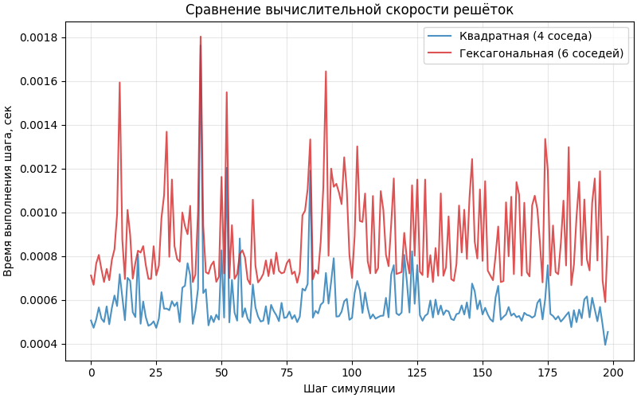
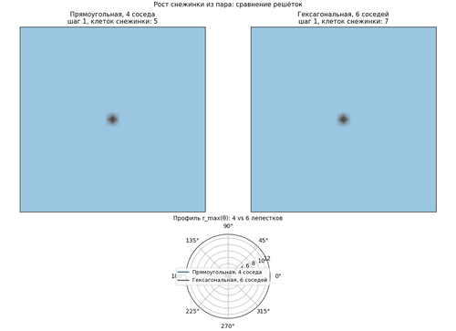
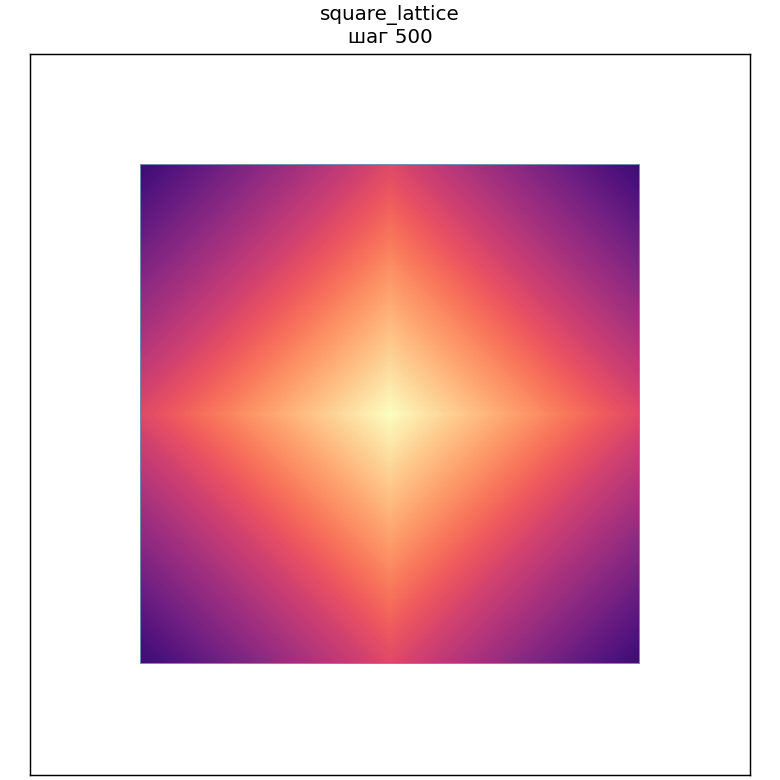
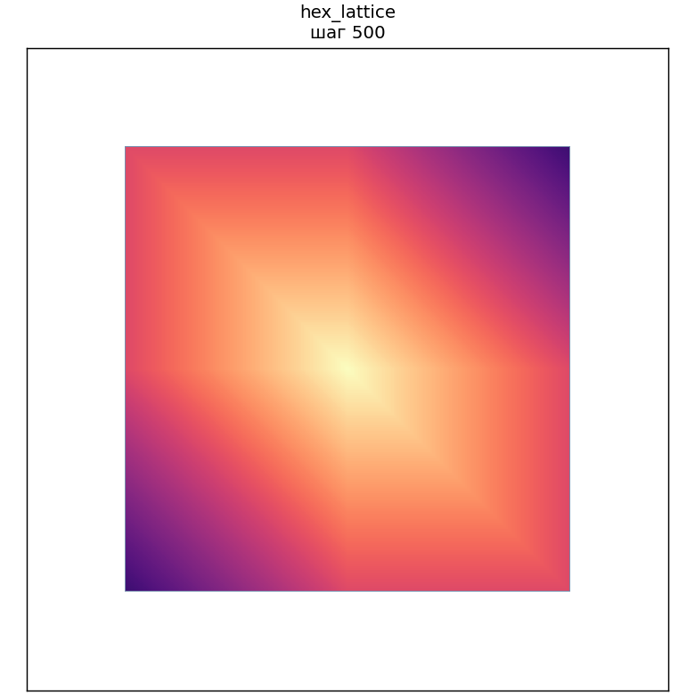

# Моделирование роста снежинки на клеточном автомате

Домашняя работа по курсу «Компьютерное моделирование». 
В работе реализована модель роста снежинки (кристалла гексагонального льда Ih) из пересыщенного водяного пара на клеточном автомате. Приложение имеет графический интерфейс на базе библиотеки PyQt5 и проводит сравнительный анализ вычислительной сложности различных решёток.

---

## 1. Тема исследования и цель работы

Тема: Влияние геометрии вычислительной решётки на морфологию растущей снежинки при одинаковых физических параметрах.

Цель: Сравнить рост снежинки на квадратной решётке (4 соседа, окрестность фон Неймана) и на гексагональной решётке (6 соседей), а также оценить вычислительные затраты каждого подхода.

Главный морфологический вывод: Выбор вычислительной решётки — это не просто техническая деталь, а физически значимое решение. Квадратная решётка навязывает кристаллу искусственную 4-лучевую симметрию (артефакт дискретизации), в то время как гексагональная решётка воспроизводит правильную 6-лучевую симметрию, характерную для реального льда.

---

## 2. Описание модели

Модель представляет собой двумерный клеточный автомат, в котором каждая ячейка описывает две фазы:
1. Пар (vapor): концентрация водяного пара в узле.
2. Лёд (ice): булево состояние, показывающее, замёрзла ли клетка.

Алгоритм одного шага:
1. Диффузия: Пар перераспределяется между соседними клетками согласно коэффициенту диффузии D.
2. Десублимация (замерзание): Если нелёдовая клетка граничит со льдом, и концентрация пара в ней превышает заданный порог (threshold), она с некоторой вероятностью замерзает. Пар в замёрзшей клетке обнуляется.

Режимы работы:
- Статика (Детерминированный): Клетка замерзает строго при превышении порога. Случайность отсутствует, что позволяет получить идеальные симметричные фракталы.
- Хаос (Вероятностный): Вероятность замерзания зависит от локальной концентрации пара и параметра p_deposit. В этом режиме появляются случайные боковые веточки, и снежинка выглядит более «живой».

---

## 3. Анализ вычислительной сложности (Скорость)

Помимо визуального сравнения, в программе реализован бенчмарк, замеряющий время выполнения одного шага клеточного автомата для каждой решётки (с использованием time.perf_counter()).

Теоретическое обоснование:
- Квадратная решётка имеет 4 соседа. На каждом шаге для вычисления диффузии выполняется 4 операции сдвига массива (np.roll).
- Гексагональная решётка имеет 6 соседей. На каждом шаге выполняется 6 операций сдвига.

Следовательно, гексагональная решётка требует больше вычислительных операций.

Эмпирические результаты:
После завершения симуляции программа выводит в консоль и сохраняет в лог точную разницу в процентах. На графике скорости (синяя линия — квадратная, красная — гексагональная) видно соотношение времен шага. В идеальных условиях красная линия должна быть выше, однако из-за особенностей кэширования процессора и накладных расходов среды выполнения линии могут пересекаться. Итоговая разница в процентах, выводимая в консоль, дает наиболее точную оценку.

Пример графика скорости

---

## 4. Ограничения модели

1. Моделируется только дендритный режим роста.
2. Отсутствует уравнение теплопроводности и диаграмма Накая, поэтому не воспроизводятся другие формы льда (пластинки, иглы, столбики).
3. Реальная кристаллография льда (разные скорости роста базисных и призматических граней) не учитывается. Анизотропия формы возникает исключительно из-за геометрии решётки.
4. Модель описывает качественную картину, а не точные физические процессы.

---

## 5. Входные параметры

В интерфейсе программы доступны следующие параметры:

### Физика
| Параметр | Описание |
|---|---|
| Режим | Выбор между детерминированной «Статикой» и вероятностным «Хаосом». |
| seed | Зерно генератора случайных чисел. Одинаковый seed дает одинаковый результат. |
| D | Коэффициент диффузии. Чем выше, тем быстрее пар подводится к фронту. |
| vapor_init | Начальная концентрация пара в сетке. |
| v_bound | Концентрация пара на границах сетки (резервуар). |
| threshold | Порог замерзания. При паре ниже этого значения клетка не замерзает. |
| p_deposit | Базовая вероятность замерзания (влияет только в режиме «Хаос»). |
| tip_bias | Нелинейность. Чем выше, тем сильнее вершины ветвей опережают в росте боковые грани (влияет в «Хаосе»). |

### Симуляция и Вывод
| Параметр | Описание |
|---|---|
| N | Размер квадратной сетки (N x N клеток). |
| Шагов | Количество итераций клеточного автомата. |
| interp | Кадров анимации на 1 шаг автомата (для плавности GIF). |
| fps | Кадров в секунду в итоговом GIF-файле. |
| dpi | Разрешение кадра. |
| gif_skip | Каждый N-й отрендеренный кадр попадает в GIF (экономия размера). |
| save_every | Шаг между сохранениями статичных PNG-снимков в папку output/snapshots. |

---

## 6. Интерфейс программы

Приложение имеет графический интерфейс на базе PyQt5. Оно не показывает живую анимацию (чтобы не нагружать процессор), а выполняет расчёт в фоновом потоке (Worker Thread) с прогресс-баром, после чего сохраняет готовый GIF, статичные снимки и график скорости.

Скриншот главного окна программы

Основные элементы интерфейса:
1. Пресеты качества: Кнопки Potato, Medium, Excellent. Позволяют в один клик настроить N, dpi, Шагов и interp под нужную скорость работы.
2. Панель параметров: Все поля ввода физических параметров и параметров симуляции.
3. Панель управления: Кнопки «Запустить симуляцию», «Прервать», прогресс-бар и лог-файл.
4. Результат: После завершения работы появляются кнопки «Открыть GIF», «Открыть папку» и «Открыть график скорости».
5. Меню «Справка»: Содержит подробную инструкцию по работе с параметрами и описание того, что изображено на графиках.

Скриншот окна справки

---

## 7. Результаты работы

Пример анимации (оптимизировано для GitHub)

Обратите внимание: стандартный пресет «Potato» или «Medium» генерирует GIF-файлы размером 1-3 МБ, которые отлично отображаются прямо в README на GitHub. Пресет «Excellent» может создать файл больше 10-20 МБ, который GitHub не покажет (появится только ссылка на скачивание). Если вам нужен именно огромный GIF, лучше загрузить его на внешний хостинг (например, Imgur) и вставить прямую ссылку.

Статичные кадры

Программа сохраняет кадры каждые N шагов (по умолчанию — каждые 100) в папку output/snapshots/.

Квадратная решётка: На полярном профиле (нижняя панель GIF) видны 4 лепестка. Рост идет вдоль осей X и Y.

Гексагональная решётка: На полярном профиле видны 6 лепестков. Рост идет в 6 направлениях, образуя правильную снежинку.

---

